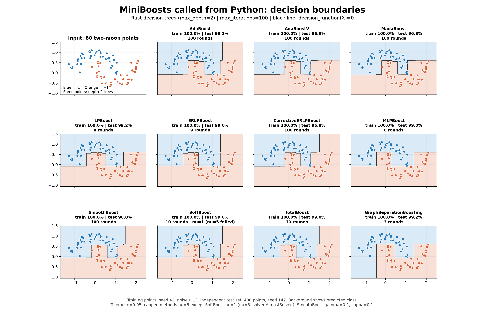
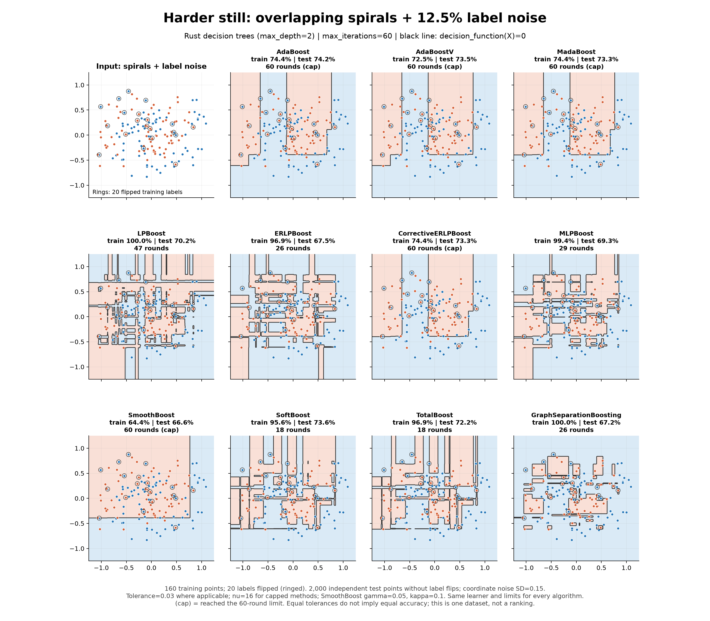

# MiniBoosts

MiniBoosts is a Rust library for implementing and comparing boosting algorithms.
Its algorithms share the `Booster`, `WeakLearner`, and `Classifier` traits, so you
can use the same data and weak learner across experiments.

Version 0.5.0 ships as one `miniboosts` crate; algorithms and utilities are
internal modules, not separate registry packages. Earlier releases have a
different API; see the [migration notes](MIGRATION.md) when upgrading.
Rust 1.85 or newer is required (edition 2024).

## Getting started

Add MiniBoosts to your application's `Cargo.toml`:

```toml
[dependencies]
miniboosts = "0.5.0"
```

The optimization routines use Clarabel for linear, quadratic, and conic
programming. No Gurobi installation or license is required.

Add the following to `src/main.rs` to train a binary classifier on a small
in-memory dataset:

```rust
use std::io::BufReader;
use miniboosts::{Sample, prelude::*};

fn main() {
    let csv = b"x,class\n-2,-1\n-1,-1\n1,1\n2,1\n";
    let sample = Sample::from_reader(BufReader::new(&csv[..]), true)
        .unwrap()
        .set_target("class");
    let learner = DecisionTreeBuilder::new(&sample)
        .max_depth(2)
        .split_by(SplitBy::Entropy)
        .build();
    let mut booster = AdaBoost::init(&sample)
        .tolerance(0.1)
        .force_quit_at(20);
    let classifier = booster.run(&learner);
    assert_eq!(classifier.predict_all(&sample), vec![-1, -1, 1, 1]);
}
```

For CSV or SVMlight files, use `SampleReader::default()`. Binary classification
labels must be `-1` and `1`, with both classes present in the training sample.
The assertion checks predictions on this training sample; use a separate test
set to evaluate performance on unseen data.

## Python bindings

The optional [Python package](python/README.md) exposes the same Rust algorithms
through classes such as `AdaBoostClassifier`, with `fit(X, y)`, `predict(X)`,
and `decision_function(X)`. Weak learners can be native decision trees or
compatible custom Python/sklearn estimators; confidence values are strictly
validated in [-1, +1]. Binary labels are encoded with a mapping warning and
restored on prediction.

From a checkout, with Rust and a Python virtual environment available:

```sh
python -m pip install ./python
```

This builds the extension locally; the Python package is not yet on PyPI.
Rust users need no Python dependencies. See the Python guide for examples,
algorithm parameters, the explicit sklearn `PredictionAdapter`, and limits.

## Decision boundaries from Python

These figures use the Python API to run all 11 algorithms with the same data
and depth-2 Rust decision trees. Point colors show training labels, background
colors show predicted classes, and black lines mark zero ensemble confidence.
`train` and `test` report accuracy; test points are generated independently.

### Two moons

80 training points with coordinate noise, with a limit of 100 rounds.
SoftBoost failed with solver status `AlmostSolved` at `nu=5`; its panel explicitly
shows a separate run with `nu=1`. The other capped methods use `nu=5`.



### Overlapping spirals with label noise

160 training points with stronger coordinate noise; 20 training labels (12.5%)
are flipped and marked with rings. Test labels are not flipped. The iteration
limit is 60, and capped methods use `nu=16`. All 11 runs completed successfully.
Fine-grained boundaries can fit corrupted labels without improving test accuracy.



These are illustrative runs, not a performance ranking or a comparison at equal
optimization accuracy. `(cap)` marks an iteration-limit stop. In particular,
CorrectiveERLP uses ShortStep and is capped at 60 in this figure; a separate
300-round-budget run stopped at round 91. Algorithm stopping conditions depend
on weak-learner assumptions and do not by themselves certify global optimality.

Reproduction scripts, seeds, parameters, results, and environment records are
available in [the figure directory](img/python/README.md).

## Algorithms

Import these types from `miniboosts` or `miniboosts::prelude`:

| Type | Source |
| --- | --- |
| `AdaBoost` | [Freund and Schapire][adaboost] |
| `AdaBoostV` | [Rätsch and Warmuth][adaboostv] |
| `MadaBoost` | [Domingo and Watanabe][madaboost] |
| `LpBoost` | [Demiriz, Bennett, and Shawe-Taylor][lpboost] |
| `ErlpBoost` | [Warmuth, Glocer, and Vishwanathan][erlpboost] |
| `CorrectiveErlpBoost` | [Shalev-Shwartz and Singer][cerlpboost] |
| `MlpBoost` | [Mitsuboshi, Hatano, and Takimoto][mlpboost] |
| `SmoothBoost` | [Servedio][smoothboost] |
| `SoftBoost` | [Warmuth, Glocer, and Rätsch][softboost] |
| `TotalBoost` | [Warmuth, Liao, and Rätsch][totalboost] |
| `GraphSeparationBoosting` | [Alon, Gonen, Hazan, and Moran][graphsepboost] |

The built-in weak learner is a [decision tree][decisiontree]. Implement
`WeakLearner` to use your own learner. The gradient boosting machine (GBM) and
regression tree implementations are not compiled into the library.
See the [migration notes](MIGRATION.md) for removed APIs.

Custom hypotheses must return consistent predictions for a fixed sample.
CorrectiveERLPBoost and MLPBoost cache training margins instead of repeatedly
evaluating earlier hypotheses. MLPBoost's cache uses O(mT) additional memory
for m training examples and T accepted hypotheses.

## Parameters and comparisons

`tolerance` is algorithm-specific. AdaBoost and MadaBoost use it to set iteration
budgets; it does not directly test measured classification error. AdaBoostV uses
it in its margin update and iteration budget. LPBoost, ERLPBoost, corrective
ERLPBoost, MLPBoost, and SoftBoost use optimization stopping criteria; TotalBoost
wraps SoftBoost with `nu = 1`. An optimization gap is not a classification-error
bound. Theoretical guarantees require the corresponding paper's weak-learning
or optimization-oracle assumptions and accurate subproblem solutions; using a
decision tree does not by itself ensure that these assumptions hold.

MLPBoost defaults to line-search Frank–Wolfe updates; CorrectiveERLPBoost defaults
to ShortStep. Both support Classic, ShortStep, and LineSearch through
`update_rule`. CorrectiveERLPBoost's coefficient sum can be below one; its
confidence values and logged margins preserve that scale.

For soft-margin methods, `nu` caps example weights at `1 / nu`, with
`1 <= nu <= number_of_examples`. It does not guarantee a particular number of
misclassified examples. SmoothBoost requires a weak-learning advantage `gamma` and a target
error parameter `kappa`; its guarantee depends on that advantage holding on each
training distribution.

ERLPBoost solves its entropy-regularized subproblems using exponential cones and
checks an independent primal/dual gap before using the dual lower bound for
stopping. This is a floating-point accuracy check; extremely small outer
tolerances can exceed the inner solver's accuracy. Failed solves panic rather
than count as convergence. SoftBoost and TotalBoost can instead stop early on
an entropy-solver accuracy failure; inspect `numerical_stop_reason()` after
training. Such a stop does not certify convergence, and final LP fitting can
still fail. See the [migration notes](MIGRATION.md) for numerical changes.

For fair comparisons, use the same data splits, preprocessing, weak learner,
and evaluation metrics. State each algorithm's stopping rule and use a common
time budget when comparing learning curves over time. Record seeds, parameters, commit,
dependencies, hardware, and thread count. Use release builds for timing and
report what was measured. Equal numeric tolerances need not imply equal accuracy.
Keep test data out of training and parameter selection.

## Run experiments and plot results

The example runner can run one algorithm or all 11 and save learning curves as
CSV files. The plotting script generates training-loss, test-loss, and
soft-margin figures. See the [experiment guide](img/README.md) for input formats,
commands, parameters, and timing details.

To list the available algorithms:

```sh
cargo run --release --locked -p miniboosts-example -- --list
```

## Development

- `src/core/`: data, traits, and shared utilities.
- `src/boosters/`, `src/weak_learners/`: algorithm implementations.
- `src/optimization/`, `src/hypotheses/`, `src/logging/`: solvers, aggregation, and measurement.
- `src/lib.rs`, `src/prelude.rs`: public exports.
- `tests/`: integration tests and shared fixtures.
- `img/example/`: non-published command-line experiment runner.

```sh
cargo test --workspace --locked
cargo check --workspace --locked
cargo fmt --all -- --check
cargo doc --workspace --locked --no-deps --open
```

See [logging usage](docs/logging.md) for CSV learning curves and timing
details. `Cargo.toml` lists the active workspace members and dependencies.
The root `Cargo.toml` declares the library's dependencies; `Cargo.lock` records
exact versions. Keep the lockfile with experiment results. CI uses `--locked`
on stable Rust and the minimum supported Rust version (1.85). Dependency updates
should be separate from numerical changes, with solver accuracy and convergence
retested. See the [release guide](RELEASING.md) for publishing `miniboosts`.

## License

MiniBoosts is licensed under [MIT](https://github.com/rmitsuboshi/miniboosts/blob/main/LICENSE). Clarabel 0.11.1 is licensed under
[Apache-2.0](https://github.com/oxfordcontrol/Clarabel.rs/blob/v0.11.1/LICENSE.md);
its license remains separate from MiniBoosts' license.

[adaboost]: https://www.sciencedirect.com/science/article/pii/S002200009791504X?via%3Dihub
[adaboostv]: http://jmlr.org/papers/v6/ratsch05a.html
[cerlpboost]: https://link.springer.com/article/10.1007/s10994-010-5173-z
[decisiontree]: https://www.amazon.co.jp/-/en/Leo-Breiman/dp/0412048418
[erlpboost]: https://www.stat.purdue.edu/~vishy/papers/WarGloVis08.pdf
[graphsepboost]: https://theoretics.episciences.org/10757
[lpboost]: https://link.springer.com/content/pdf/10.1023/A:1012470815092.pdf
[mlpboost]: https://arxiv.org/abs/2209.10831
[madaboost]: https://www.learningtheory.org/colt2000/papers/DomingoWatanabe.pdf
[smoothboost]: https://link.springer.com/chapter/10.1007/3-540-44581-1_31
[softboost]: https://proceedings.neurips.cc/paper/2007/file/cfbce4c1d7c425baf21d6b6f2babe6be-Paper.pdf
[totalboost]: https://dl.acm.org/doi/10.1145/1143844.1143970
